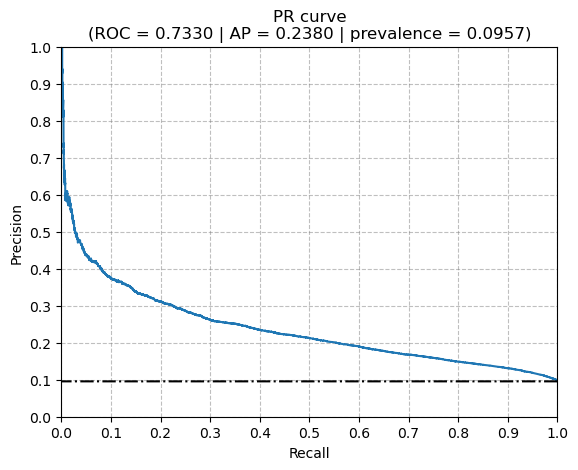
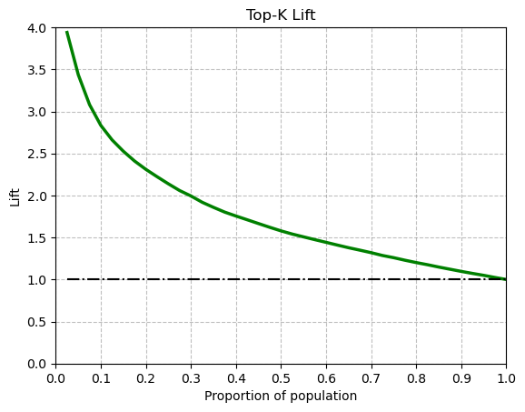

# Ranking Clinical Trial Termination Risk with Machine Learning

In this project, I used publicly available information on clinical trials to train a model which provides insights regarding which trials are comparatively more likely to be terminated. A great deal of time and resources can be dedicated to running a clinical trial, therefore having insight into which trials carry a higher risk of not completing could be useful when making decisions on which trials to grant such resources. The final model trained in this project does not provide a calibrated probability of termination for a given trial but instead functions to rank termination risk relative to other trials. Its utility therefore would be in making decisions given a set of proposed trials to evaluate and choose from.

## Data Used

Data was taken from the AACT database which is publicly available and updated from studies registered in ClinicalTrials.gov regularly. Using data directly from ClinicalTrials.gov was originally considered but the AACT database was ultimately chosen for ease of reproducibility and data exploration. Descriptions of each table in the database can be found in `data/aact_tables.xlsx`, and further information regarding the columns within each table can be found on the AACT website [here](https://aact.ctti-clinicaltrials.org/documentation).

The training target chosen was `overall_status`, found in the `studies` table. In order to train models for a binary outcome, only trials that were either 'COMPLETED' or 'TERMINATED' were chosen for the dataset. This excludes any ongoing trials, suspended trials that may resume, and trials that are registered but haven't began. The `feature_engineering.ipynb` notebook contains a list of the final feature set. The final dataset contained 338,720 total samples which had a termination rate of ~9.6%.

Instructions for downloading the data and where to place it to reproduce the results of this project can be found in `data/README.md`.

## Methods

### Preprocessing

Numerical and categorical features were separated. Heavy tailed features within the numerical features were identified by comparing the 0.95, 0.99, and 1.00 quantiles and then separated into a different preprocessing pipeline. Typical imputation and scaling was done for numerical features. Categorical preprocessing mainly consisted of one hot encoding.

### Modeling

Two dummy models were used for comparison to ensure that models trained were receiving some useful signal. The baseline models compared were logistic regression, support vector machine, and gradient boosting. The scoring metrics used were PR-AUC and ROC-AUC, and due to the low prevalence of termination, PR-AUC was chosen as the primary metric. The baseline models were scored using a 5-fold cross validation to prevent leakage. The HistGradientBoostingClassifier (HGB) model had the best PR-AUC (~0.226) which was more than 2 times greater than the baseline positive rate of termination, indicating that the dataset contained some useful signal. A randomized search cross-validation was done to search for more optimal parameters for the HGB model. Ultimately, no significant improvement in PR-AUC was found and so the baseline model was chosen as the final model for simplicity.

## Results

### Average Precision (PR-AUC) & ROC-AUC

HistGradientBoostingClassifier with ROC-AUC of ~0.7330 and PR-AUC (AP) of ~0.2380 when evaluated on test data. PR-AUC is ~2.49 times greater than prevalence (dashed horizontal line on PR curve).

\
*PR curve for final model (HGB) with scoring metrics given.*

### Ranking Utility (Top-K Lift)

To evaluate the model's utility in ranking trials based on their risk of terminating, Top-K Lift was used.

| k(%) | Termination rate in top-k% |   Lift@k |
| :--- | :------------------------: | -------: |
| 1    |          0.440898          | 4.608155 |
| 5    |          0.328767          | 3.436189 |
| 10   |          0.271138          | 2.833868 |
| 20   |          0.221068          | 2.310541 |

\
*Lift curve for final model. To show model's ranking utility, dashed line at y=1.0 represents baseline.*

## Reproducibility

To reproduce the results of this project first clone the repository while in the directory you would like the project folder to be in.

```bash
git clone https://github.com/danherbb/clinical-trial-termination-risk.git
```

Then create a `data/raw` directory which will contain the AACT tables as flat text files.

```bash
cd clinical-trial-termination-risk/data
mkdir raw
```

Further instructions for downloading the relevant files can be found in `data/README.md`. Complete those instructions before continuing.

It is recommended to use a conda environment to prevent issues due to dependencies. The python version used for this project is 3.11

```bash
conda create --name term-risk-ml python=3.11
conda activate term-risk-ml
pip install -r requirements.txt
```

You should then be ready to first run `feature_engineering.ipynb`, which will export the dataset as `data/processed/model_data.csv`, and then run `modeling.ipynb`, which will train and evaluate the model. Note that performing the randomized search of hyperparameters will likely take more than 5 minutes to run.

## Model Limitations

- Utility mainly in ranking termination risk of several trials; probabilities are treated as **risk scores** not calibrated probabilities
- Trained only on trials that are either terminated or completed and therefore excludes ongoing or delayed trials
- Uses monthly snapshot from AACT database and therefore does not incorporate new trials in AACT database automatically
- There could potentially be more useful features that were not incorporated into the dataset such as conditions studied

## Future Improvements

- Improve feature engineering by grouping conditions into a usable number of categories and then retraining model and analyzing for improvement
- Integrate the daily updated AACT database with PostgreSQL instead of downloading a snapshot manually.
