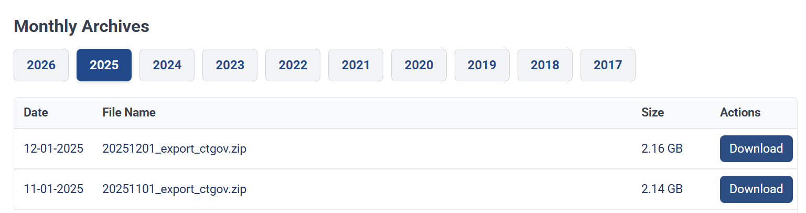

# Instructions for Downloading Data

The data used for this project come from the December snapshot of the AACT database. Flat text files were used and loaded for feature engineering using pandas. Files which were downloaded can be found [here](https://aact.ctti-clinicaltrials.org/downloads/snapshots?type=flatfiles). Any snapshot should be usable for reproducing the feature engineering and modeling done for this project, but to get the same snapshot used, scroll down to 'Monthly Archives' and click '2025' to find the December 2025 snapshot (20251201_export_ctgov.zip ~2.16GB).

## Locations for downloaded files
Unzip downloaded file to get the *.txt files corresponding to each table in the AACT database. Then place all files in the directory `data/raw/`

## Schema
Descriptions for each table corresponding to one flat text file can be found in `aact_tables.xlsx`. Further information for the columns within each table can found [here](https://aact.ctti-clinicaltrials.org/documentation). This project uses only a subset of tables.
